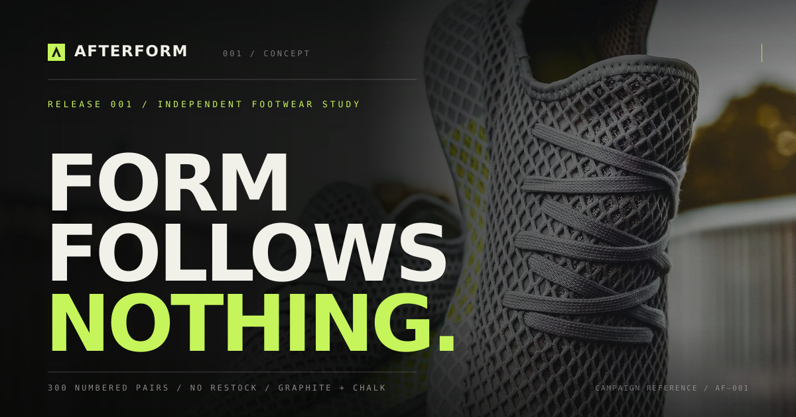

# AFTERFORM 001 — “FORM FOLLOWS NOTHING.”

**Live concept:** <https://afterform-six.vercel.app> · **Repository:** <https://github.com/nexusauth0-cloud/afterform>



A single-product sneaker concept for **AFTERFORM**, a fictional independent footwear concept — not a registered company or live retailer. This is a design-study build: it exercises a complete premium commerce experience (campaign, product study, sizing, bag, checkout boundary and waitlist) without pretending to be an operating store.

> **AFTERFORM is a fictional concept.** Product specifications, the proposed 300-pair edition, the 42-pair frontend demo allocation, pricing and campaign copy are illustrative. Reference photography shows third-party footwear and locations and is **not** production photography of an AFTERFORM product. See [credits](https://afterform-six.vercel.app/credits) and [Data & demo boundaries](#data--demo-boundaries).

---

## Contents

- [Stack](#stack)
- [Quick start](#quick-start)
- [Scripts](#scripts)
- [Environment variables](#environment-variables)
- [Routes](#routes)
- [Drop states](#drop-states)
- [Edition vs. frontend inventory](#edition-vs-frontend-inventory)
- [Checkout boundary](#checkout-boundary)
- [Waitlist delivery](#waitlist-delivery)
- [Data & demo boundaries](#data--demo-boundaries)
- [Accessibility](#accessibility)
- [Imagery & fonts](#imagery--fonts)
- [Directory structure](#directory-structure)
- [Deployment](#deployment)

---

## Stack

| Layer | Choice |
| --- | --- |
| Framework | [Next.js 16.4.6](https://nextjs.org) — App Router, React Server Components |
| UI runtime | React 19.3 |
| Language | TypeScript 5 |
| Styling | Tailwind CSS 4.3.3 (Turbopack plugin) |
| Motion | Framer Motion 14 |
| Icons | Lucide React |
| Class merging | `tailwind-merge` |
| Tests | Vitest 5 |
| Fonts | Anton, Archivo, IBM Plex Mono — self-hosted WOFF2 via `next/font/local` |

No UI kit, no state library, no payment SDK. Cart state is React context + `localStorage`; Stripe is called with the server-side REST API.

---

## Quick start

Requires Node.js 20+ (developed on Node 24) and npm.

```bash
cd afterform
npm install
cp .env.example .env.local
npm run dev
```

Open <http://localhost:3000>.

The site runs without any environment variables. Drop dates, Stripe and waitlist delivery all have explicit, honest defaults; missing configuration degrades to a visible demo boundary rather than a fake success state.

---

## Scripts

| Command | Purpose |
| --- | --- |
| `npm run dev` | Development server (Turbopack) |
| `npm run build` | Production build |
| `npm run start` | Serve the production build |
| `npm run typecheck` | `tsc --noEmit` |
| `npm run lint` | ESLint |
| `npm test` | Vitest unit tests (one run) |
| `npm run test:watch` | Vitest in watch mode |
| `npm run check` | typecheck → lint → test → build |

---

## Environment variables

Copy `.env.example` to `.env.local`. All are optional for local review.

| Variable | Scope | Default | Notes |
| --- | --- | --- | --- |
| `NEXT_PUBLIC_SITE_URL` | Public | `http://localhost:3000` | Canonical URL for metadata, Open Graph, sitemap, JSON-LD. On Vercel, `VERCEL_PROJECT_PRODUCTION_URL` is used as a fallback. |
| `NEXT_PUBLIC_DROP_LAUNCH_AT` | Public | `2026-11-17T00:00:00+01:00` | ISO 8601 with explicit offset. |
| `NEXT_PUBLIC_DROP_CLOSE_AT` | Public | `2026-11-24T23:59:59+01:00` | ISO 8601 with explicit offset. |
| `NEXT_PUBLIC_FORCE_SOLD_OUT` | Public | `false` | `true` archives the release regardless of dates. |
| `STRIPE_SECRET_KEY` | Server only | unset | Enables Stripe Checkout. Use a test key while reviewing. |
| `WAITLIST_WEBHOOK_URL` | Server only | unset | Option A: POST each signup to an automation endpoint. |
| `RESEND_API_KEY` | Server only | unset | Option B: notify by email through Resend. |
| `WAITLIST_FROM_EMAIL` | Server only | unset | Resend sender, e.g. `AFTERFORM <list@example.com>`. |
| `WAITLIST_TO_EMAIL` | Server only | unset | Resend recipient for signup notifications. |

`NEXT_PUBLIC_*` values are inlined at build time. Changing them requires a rebuild/redeploy. `STRIPE_SECRET_KEY` and the `WAITLIST_*` credentials are read only on the server.

---

## Routes

| Route | Type | Description |
| --- | --- | --- |
| `/` | Static | Campaign: hero, ticker, acquire, inspector, manifesto, tech file, lookbook, waitlist |
| `/checkout` | Dynamic | Bag review, delivery region, payment boundary |
| `/checkout/success` | Dynamic | Stripe return verification; only reports paid when Stripe says `payment_status=paid` |
| `/credits` | Static | Image, font, data and commerce disclosures |
| `/api/checkout` | Dynamic | Validates the bag server-side; creates a Stripe Checkout session or returns `503 stripe_not_configured` |
| `/api/waitlist` | Dynamic | Honeypot + validation; webhook, Resend, or explicit demo response |
| `/robots.txt`, `/sitemap.xml` | Static | Generated from metadata routes |
| `/opengraph-image.jpg`, `/twitter-image.jpg` | Static | Social cards |

A custom `not-found` and route-level `error` page are included.

---

## Drop states

The storefront resolves one of four phases from the configured dates and the demo allocation:

| Phase | Behaviour |
| --- | --- |
| `upcoming` | Countdown to launch; purchase UI replaced by release information |
| `live` | Countdown to close; sizes, bag and checkout enabled |
| `sold_out` | Archive panel; no size selection or checkout |
| `closed` | Archive panel; no size selection or checkout |

Preview the archive at any time:

```text
http://localhost:3000/?preview=soldout
```

or set `NEXT_PUBLIC_FORCE_SOLD_OUT=true` and rebuild.

The countdown is client-side and hydration-safe: the server renders a stable placeholder, then the browser clock takes over.

---

## Edition vs. frontend inventory

These are separate concepts and are labelled separately in the interface:

| Concept | Meaning |
| --- | --- |
| **Proposed campaign edition — 300 numbered pairs** | A fictional campaign premise. It is not a production run, a warehouse quantity or evidence of customer demand. |
| **Frontend demo allocation — 42 pairs across 12 sizes** | Illustrative browser-only data used to exercise available, low-stock and sold-out states. It is not connected to a warehouse and is not reserved or decremented by checkout. |

The product narrative may use “edition 001” and “no restock” as campaign language. Every commercial surface that could be mistaken for live stock is labelled as demo or illustrative.

---

## Checkout boundary

The bag is real client state, but **no order is created or stored**. The checkout screen summarizes lines, region, promo and totals, then calls `POST /api/checkout`.

- **With `STRIPE_SECRET_KEY`** — the server validates sizes, quantities, region and promo code, builds line items plus shipping, and creates a Stripe Checkout session with `success_url=/checkout/success?session_id={CHECKOUT_SESSION_ID}`. Stripe collects payment and address details.
- **Without `STRIPE_SECRET_KEY`** — the API returns HTTP 503 with `stripe_not_configured`. The UI shows an explicit “not connected” state and disables the payment CTA. No fake redirect or success screen.
- **Return page** — fetches the session server-side. Only `payment_status=paid` produces a paid state. Unpaid, missing, invalid, unconfigured and API-error returns each get an honest message.

Inventory is not reserved or decremented by checkout. The demo allocation lives only in the browser session.

Promo code `FORM10` takes 10% off the subtotal in this preview.

---

## Waitlist delivery

`POST /api/waitlist` validates the email, requires consent and ignores honeypot submissions. Delivery is intentionally explicit:

1. `WAITLIST_WEBHOOK_URL` — forwards the signup and reports `mode: "webhook"` only on a 2xx response.
2. `RESEND_API_KEY` + `WAITLIST_FROM_EMAIL` + `WAITLIST_TO_EMAIL` — sends a notification through Resend and reports `mode: "resend"` on success.
3. Neither configured — returns `mode: "demo"` with a message stating the email was **not stored or sent**.

There is no database. Configure a webhook/Resend for a functional capture flow, or replace the route with your own backend.

---

## Data & demo boundaries

Everything in this repository is a design study. Specifically:

- **Product** — AFTERFORM 001 and its materials, mass, stack heights and construction notes are fictional targets, not a production datasheet.
- **Edition** — the proposed 300-pair campaign edition is fictional. It is not a production run or warehouse quantity.
- **Inventory** — a separate fixed 42-pair demo allocation across 12 sizes is used to exercise available, low-stock and sold-out states. No warehouse connection, and checkout does not reserve stock.
- **Pricing** — €285, illustrative. Shipping rates and ETAs are illustrative.
- **Orders** — no order record, fulfilment, tax calculation or stock reservation exists.
- **Reviews / social proof** — none are fabricated; the site contains no customer reviews, sales claims or customer-demand signals.
- **Photography** — reference imagery only. See below.
- **Brand** — AFTERFORM is a fictional independent footwear concept and is not a registered company; no affiliation with any depicted footwear brand is claimed.

These disclosures are repeated in the UI (`/credits`, lookbook captions, bag and checkout notes) rather than hidden in this file.

---

## Accessibility

- Semantic landmarks, one `h1` per page and labelled sections.
- Skip link to main content.
- Dialog/drawer primitive with focus trap, Escape to close, focus restore, `aria-modal`, labelled titles and body scroll lock.
- Lookbook lightbox with previous/next buttons, ArrowLeft/ArrowRight, Escape and visible focus.
- Size selector is a labelled radio-style group with `aria-pressed`, stock descriptions and disabled unavailable sizes.
- Live regions for cart announcements, promo feedback, waitlist status and toasts.
- Keyboard-operable navigation, mobile menu, promo form and purchase bar.
- `prefers-reduced-motion` respected by reveal animations, countdown transitions and dialog motion.
- Colour pairings aim for AA on body copy; small mono labels are decorative/supporting text.

---

## Imagery & fonts

**Photography.** All images in `public/images` were downloaded from [Unsplash](https://unsplash.com) and are used under the [Unsplash License](https://unsplash.com/license). They depict third-party footwear and architecture, not a manufactured AFTERFORM product. Each asset and its source URL is registered in `data/assets.ts`; grouped credits are rendered at `/credits`.

Replace the files in `public/images` (and update `data/assets.ts`) with original licensed product photography before any commercial use.

**Fonts.** Anton, Archivo and IBM Plex Mono are licensed under the SIL Open Font License 1.1 and self-hosted as WOFF2 in `public/fonts`.

---

## Directory structure

```text
afterform/
├── app/
│   ├── api/
│   │   ├── checkout/route.ts      # Stripe session boundary
│   │   └── waitlist/route.ts      # webhook / Resend / demo
│   ├── checkout/
│   │   ├── page.tsx
│   │   └── success/page.tsx       # server-side Stripe verification
│   ├── credits/page.tsx
│   ├── error.tsx
│   ├── not-found.tsx
│   ├── globals.css                # tokens, typography, utilities
│   ├── layout.tsx                 # fonts, metadata, chrome
│   ├── page.tsx                   # campaign composition
│   ├── robots.ts / sitemap.ts
│   └── icon.svg, opengraph-image.jpg, twitter-image.jpg
├── components/
│   ├── cart/                      # drawer, line, promo, mobile bar
│   ├── checkout/                  # checkout experience, cart clearing
│   ├── hero/                      # hero, countdown
│   ├── layout/                    # announcement, header, menu, ticker, footer
│   ├── lookbook/                  # asymmetric grid + lightbox
│   ├── product/                   # acquire, inspector, size selector/guide
│   ├── providers/                 # drop, cart, selection, toast
│   ├── story/                     # manifesto / editorial
│   ├── tech/                      # liquid-glass specification panels
│   ├── ui/                        # button, dialog, reveal, labels, logo
│   └── waitlist/
├── data/                          # assets, campaign, inventory, lookbook, product, story
├── lib/                           # cart math, drop phase, formatting, cn, tests
├── public/
│   ├── fonts/                     # WOFF2 (OFL)
│   └── images/                    # Unsplash reference imagery
├── types/
├── .env.example
├── next.config.ts
├── vitest.config.mts
└── package.json
```

---

## Deployment

### Vercel

```bash
npx vercel@latest link      # link or create the project
npx vercel@latest          # preview deployment
npx vercel@latest --prod   # production deployment
```

Set the environment variables from the table above in the Vercel project (Production and Preview as appropriate). `NEXT_PUBLIC_SITE_URL` should be the final canonical origin; on the standard Vercel domain the app also falls back to `VERCEL_PROJECT_PRODUCTION_URL`.

### Any Node host

```bash
npm ci
npm run build
npm run start -- -H 0.0.0.0 -p 3000
```

The app needs no database, queue or object storage. The only external calls are to Stripe (checkout), Unsplash-hosted assets were downloaded locally, Resend/webhook (waitlist, optional), so no runtime image allow-list is required.

---

## License

Source code is provided as a concept/demo. Reference photography remains subject to the Unsplash License; fonts remain subject to the SIL OFL 1.1. See `/credits` for per-asset sources.
